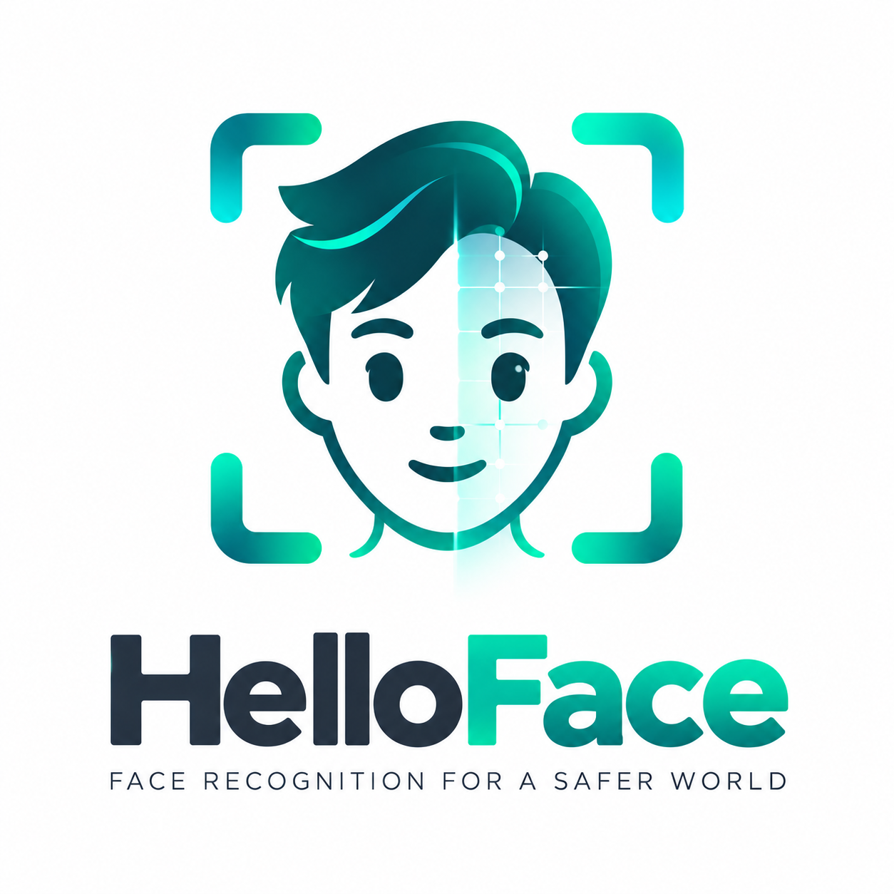

  

# HelloFace SDK Integration Demo

English | [简体中文](README.zh-CN.md)

**SDK 0.0.1 Beta** · Runnable Demo source and SDK dependencies for Android, iOS and HarmonyOS.

Face detection, capture, liveness, 1:1 comparison and 1:N/M:N search run on device. The Demo also shows camera settings, face-library management and batch imports. Online image import requires a network connection.

## Quick start

| Platform | Requirements | Open and run |
|---|---|---|
| Android | Android 6.0+; arm64/armv7; JDK 17, SDK 36 | Open `platforms/Android` in Android Studio; run `demo` |
| iOS | iOS 15+; Xcode with Swift 6 | Open `platforms/iOS/HiFaceDemo.xcodeproj`; configure your Team and run on iPhone |
| HarmonyOS | API 20+; arm64; DevEco Studio 26 | Open `platforms/Harmony`; configure HAP signing and run `demo` |

Integration guides:

- [Android](platforms/Android/README.md) · [SDK API](platforms/Android/docs/SDK.md)
- [iOS](platforms/iOS/README.md) · [SDK API](platforms/iOS/SDK/API.md)
- [HarmonyOS](platforms/Harmony/README.md) · [SDK API](platforms/Harmony/SDK.md)

## Downloads and expiry

[Android build runs](https://github.com/FaceSDKPro/HelloFace/actions/workflows/android-demo.yml) provide the `HelloFace-Android-test-apk` artifact. Local Debug APKs are under `platforms/Android/demo/build/outputs/apk/debug/`. Use your own release signing credentials; iOS and HarmonyOS also require your App signing.

Beta expires at **2026-12-26 00:00 (UTC+08:00)**.

[Updates and details](https://github.com/FaceSDKPro/) · [Report an issue](https://github.com/FaceSDKPro/HelloFace/issues). Include SDK version, device, OS, error code and reproduction steps; remove sensitive data from logs.
